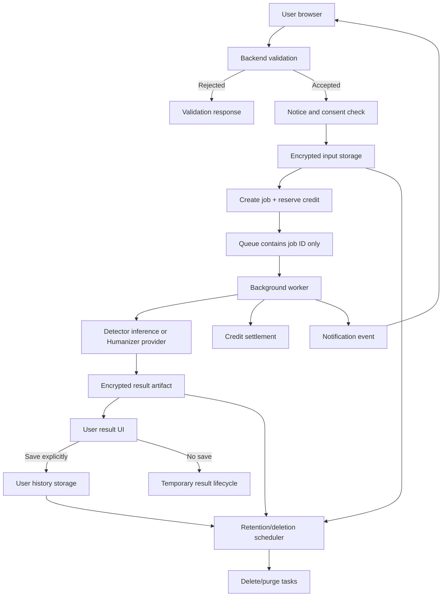
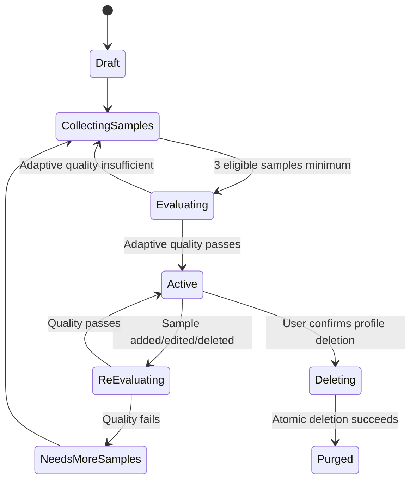

# Lexora Data Flow and Data Lifecycle

- **Tanggal:** 2026-11-17
- **Status:** Logical data-flow baseline; physical retention values and provider regions remain launch gates.
- **Related:** [System Design](SYSTEM-DESIGN.md), [Privacy and Legal Readiness](../docs/PRIVACY-AND-LEGAL-READINESS.md).

## 1. Data classification

| Class | Examples | Controls |
|---|---|---|
| Public | Landing page copy, public help articles | Public CDN/cache |
| Internal | Model configuration, feature flags, operational metrics | Staff/service access, audit for changes |
| Confidential | Account identity, payment references, support ticket metadata, credit ledger | Authenticated access, least privilege, encryption |
| Restricted | Raw text, uploaded documents, Humanizer samples, generated results, OAuth/payment secrets, provider API keys | Encryption, scoped access, no general logs, no default Admin access |

## 2. Data flow overview

## 3. User text ingestion

1. Browser sends text or uploads a file over HTTPS.
2. Backend validates authentication/guest session, feature entitlement, input size, supported format, language, and rate limit.
3. Privacy Notice and required processing basis are checked; optional research/training consent is separate.
4. Uploaded files enter private quarantine storage.
5. File validation and extraction run in a worker sandbox.
6. Extracted text is stored encrypted or in a private object, referenced by an opaque ID.
7. Job record and credit reservation are created in one database transaction.
8. Queue message contains only `job_id`, trace ID, and non-sensitive routing metadata.

Raw text must not be placed in Redis job payloads, application logs, error messages, analytics events, or URLs.

## 4. AI processing flow

### Detector
- Worker loads input from restricted storage.
- FastAPI receives the minimum necessary text and a job-scoped request ID.
- Inference response contains overall label, segment labels, evidence metadata, warnings, model version, and configuration version.
- Worker validates output schema, stores result, settles credits, and emits a completion event.
- Unsupported language or insufficient evidence results in UNCERTAIN rather than a forced authorship label.

### Humanizer
- Worker loads text and an immutable profile snapshot if a personal profile is selected.
- Provider adapter sends only the required text and instructions.
- Provider request metadata includes model/config version, provider request ID, and cost/usage metadata.
- Provider prompts/responses must not be used for provider training; if the provider setting/contract cannot guarantee the required restriction, that provider is blocked from production.
- Worker stores result and usage, settles credits, and emits completion event.
- Profile deletion does not alter an already-running document job snapshot.

## 5. Humanizer profile lifecycle

- Sample versions are immutable.
- Each sample stores size, hash, provenance, creation time, and consent linkage.
- A profile is usable only after the hard gate and adaptive assessment pass.
- Profile deletion is permanent after confirmation and must follow the profile-deletion decisions in the Decision Log.
- Sample deletion has a separate Recently Deleted state with a 30-day recovery window; restoration applies to samples, not deleted profiles.
- Deletion failure must leave all profile data intact.

## 6. Credit and payment lifecycle

### Credit lots
- Each lot records source, grant amount, remaining amount, creation time, expiry, and transaction reference.
- Purchased credit lots do not expire.
- Registered bonus/reward lots expire after seven days.
- Guest trial-credit lots expire 24 hours after grant and are bound to a guest session. Guest rewarded ads are disabled in MVP.
- Spend the eligible lot with the nearest expiry first; purchased credits are used after expiring promotional lots according to the SRS.

### Reservations
- Estimate is shown to user before processing.
- Reservation is recorded in PostgreSQL before job queueing.
- Settlement charges verified usage up to the reserved estimate.
- Unused reservation is released.
- Failure before result delivery releases the full reservation.
- A duplicate callback or retry cannot create duplicate ledger entries.

### Payments
- Browser redirect is not payment proof.
- Verified provider webhook and reconciliation update payment status.
- Credit lot creation occurs once after Paid status is verified.
- Refund is a separate auditable transaction referencing the original payment.

## 7. Admin and support access

- Admin/Moderator views operate on metadata by default.
- Raw text access requires a relevant ticket/report, explicit user consent, authorized role, minimum object scope, and maximum one-hour access.
- Each grant, read, export, and revocation is audited.
- Consent expiry or ticket closure revokes the grant.
- Support ticket attachments are disabled in MVP.

## 8. Retention and deletion matrix

Exact periods marked TBD must be decided before production. Do not invent retention promises in UI copy.

| Data class | Proposed lifecycle | Retention status |
|---|---|---|
| Guest input and result | Active session/job, then temporary cleanup unless user explicitly saves where supported | Technical expiry TBD |
| Detector input/result | Processing retention, then optional user history if feature is enabled | History retention TBD |
| Humanizer input/result | Active job; result saved only by explicit user action | History quota/retention TBD |
| Humanizer samples | Active until user deletion; Recently Deleted for 30 days | 30-day recovery window decided |
| Humanizer profile versions | Active/current plus bounded history | Maximum version count decided elsewhere; purge behavior to verify |
| Uploaded source files | Quarantine, extraction, active job, then cleanup or explicit saved artifact | Temporary retention TBD |
| Credit ledger | Financial/audit record | Legal retention period TBD |
| Payment records | Transaction and refund history | Legal/provider retention period TBD |
| Support tickets | Open through closed lifecycle | Retention period TBD |
| Notifications | Delivery and read state | Retention period TBD |
| Security/audit logs | Security and privileged-action evidence | Retention period TBD |
| Backups | Encrypted snapshots and restore points | Retention/RPO/RTO TBD |
| Provider-side data | Provider-specific prompt/log retention and deletion | Contract/region review required |

## 9. Deletion propagation

A deletion request must create a tracked workflow covering:
1. Primary database rows and dependent records.
2. Private object storage artifacts and versions.
3. Cache and queue payloads.
4. Search indexes or derived stores, if introduced.
5. Provider-side data where supported by the provider contract/API.
6. Backups, which may expire on a documented backup schedule rather than being immediately rewritten.
7. Audit records and legal holds, which may require restricted retention.

The user-facing status must distinguish:
- Request received.
- Identity verified.
- Deletion in progress.
- Completed for active systems.
- Exceptions/retained records (with reason).
- Backup/provider expiry still pending, if applicable.

Do not state “permanently deleted everywhere” unless every relevant storage and provider layer has been verified.

## 10. Consent and research dataset separation

- Production content is not training data by default.
- Optional research consent is stored separately from service acceptance.
- Research pipeline reads only explicitly consented, provenance-complete records.
- Withdrawal propagates to queued research jobs and future dataset releases.
- Research dataset exports are versioned and carry lineage and license/consent references.
- Training dataset splits use group/source lineage to prevent leakage.

## 11. Data flow security controls

- TLS for all public and service-to-service traffic.
- Encryption at rest for database, object storage, backups, and secrets.
- Short-lived signed URLs; never public bucket access.
- Scoped service identities for web, worker, detector, and storage.
- No raw text in logs/telemetry by default.
- No provider API key in browser bundles.
- File quarantine and malware/type validation before extraction.
- Idempotency keys for job, payment, reward, refund, and notification events.
- Access grants and deletion tasks are auditable.
