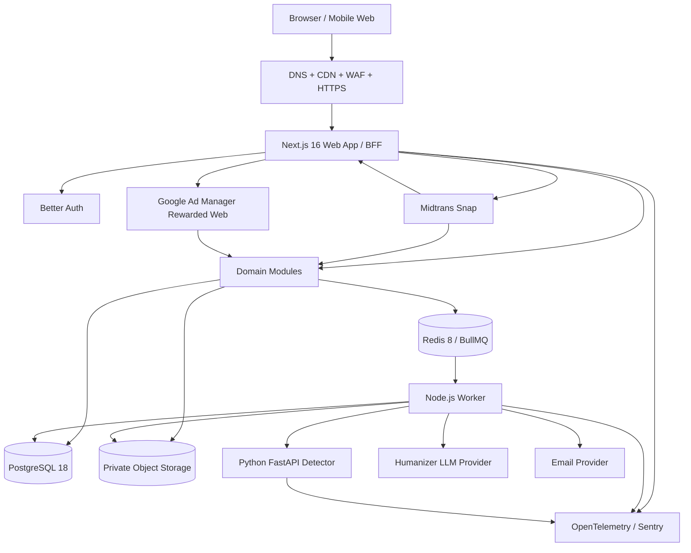
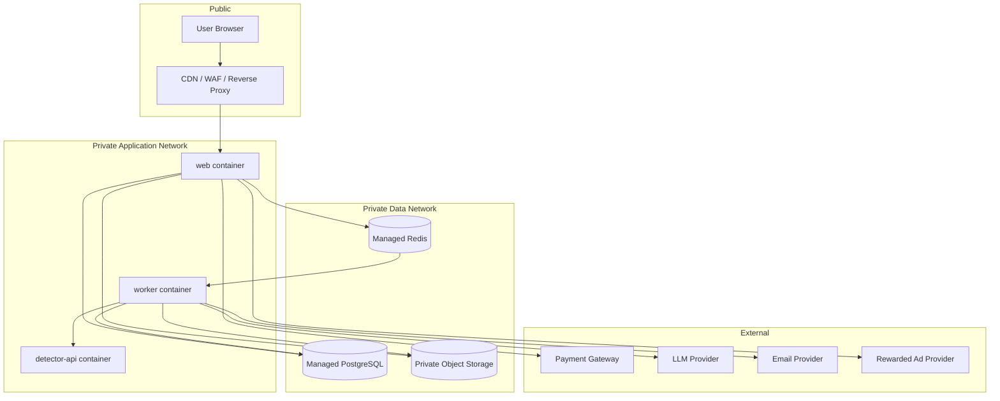
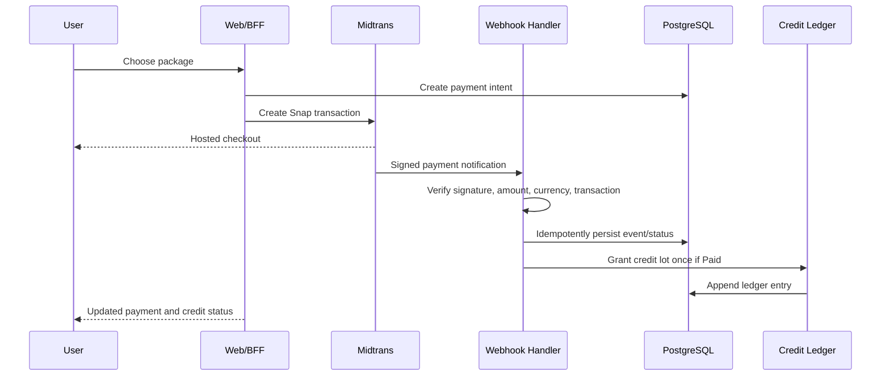

# Lexora System Design

- **Tanggal:** 2026-11-17
- **Status:** Baseline System Design for MVP.
- **Requirement source:** [System Requirements Analysis](SYSTEM-REQUIREMENTS-ANALYSIS.md).
- **Decision source:** [Decision Log](DECISION-LOG.md).
- **Technology recommendation:** [Technology Evaluation](TECHNOLOGY-EVALUATION.md).
- **Scope:** design only. No application implementation is included in this task.

## 1. Architecture decision

Use a **modular monolith** for product/business logic, with two separately deployable execution processes:
1. Next.js web application (UI + BFF/API).
2. Node.js background worker for BullMQ jobs.

The Detector model is exposed through a dedicated Python FastAPI inference service. This is the only domain-specific service separated from the TypeScript application at MVP.

Do not split every business module into a microservice. Account, credits, payments, support, notifications, Admin, and privacy share transactional state and should remain within one application boundary until scale or team ownership justifies separation.

## 2. Logical architecture



## 3. Deployment topology



Rules:
- PostgreSQL is the source of truth for business state.
- Redis is a queue/cache transport, not a source of truth for credits or payment status.
- Object storage is private by default; access uses short-lived signed URLs.
- Worker and Detector API are not directly exposed to the public internet.
- Provider secrets exist only in server-side secret storage.
- No raw text is included in queue payloads or general telemetry.

## 4. Monorepo boundaries

```text
lexora/
├── apps/
│   ├── web/                    # Next.js UI, server components, BFF, auth
│   ├── worker/                 # BullMQ processors, schedulers, webhooks
│   └── detector-api/           # Python FastAPI inference
├── packages/
│   ├── domain/                 # Domain rules and state machines
│   ├── db/                     # Drizzle schema, queries, migrations
│   ├── contracts/              # Zod request/response/event schemas
│   ├── ui/                     # Design tokens and shared UI
│   └── config/                 # Typed runtime configuration
├── infra/
│   ├── docker/
│   ├── deployment/
│   └── monitoring/
├── docs/
└── plan/
```

## 5. Domain modules and ownership

| Module | Owns | Must not own |
|---|---|---|
| Identity & Account | Users, auth identities, sessions, guest sessions, account state | Credit balance calculations |
| Detector | Analyses, segments, language/quality warnings, model version reference | Payment or credit ledger |
| Humanizer | Jobs, result artifacts, selected style, history | Direct provider secrets in browser |
| Style Profiles | Profiles, samples, immutable versions, evaluations, profile state | Document job state after snapshot |
| File Processing | Upload metadata, quarantine, extraction results, signed URLs | User authorization decisions |
| Credit Ledger | Credit lots, ledger entries, reservations, settlement, expiry | Payment provider truth |
| Payment | Payment intents, transactions, webhook events, refunds, reconciliation | Direct balance mutation |
| Notification | Templates, preferences, delivery attempts, idempotency | Transaction state mutation |
| Support | Tickets, messages, assignment, status | Default access to raw text |
| Admin & RBAC | Roles, permissions, privileged actions, audit logs | Unrestricted user text access |
| Privacy | Consent records, privacy requests, retention/deletion workflows, processor inventory | Ad hoc deletion outside approved workflows |
| Operations | Job lifecycle, retries, cancellation, incidents, service status | Credit balance mutation outside ledger APIs |

## 6. Core job processing

### 6.1 Job creation
1. Web validates authentication, input size, file state, language, feature entitlement, and balance.
2. Web calculates an estimate and displays it.
3. User confirms; credit service reserves the estimate in a database transaction.
4. Job record is created with an idempotency key and a reference to encrypted input storage.
5. Queue message contains only job ID, trace ID, and non-sensitive routing metadata.
6. Worker loads the input from private storage using service credentials.

### 6.2 Worker execution
1. Worker transitions job from Waiting to Processing atomically.
2. Worker fetches a versioned provider/model configuration.
3. Detector calls the internal FastAPI inference API; Humanizer calls the configured LLM adapter.
4. Worker stores result artifact and structured metadata.
5. Worker settles verified usage and releases unused reservation.
6. Worker transitions job to Completed or Failed.
7. Notification is emitted through an outbox/idempotent event.

### 6.3 Retry and cancellation
- Retry only transient errors, at most twice with exponential backoff and jitter.
- Reuse the same job idempotency key.
- Waiting cancellation immediately transitions to Cancelled and releases reservation.
- Processing cancellation is best-effort; terminal state follows worker/provider confirmation.
- If completion wins the race, state is Completed.
- No retry or callback can create duplicate charge/result/refund.

## 7. Payment processing



The redirect return URL is informational only. Webhook verification and reconciliation determine whether payment is Paid.

## 8. Credit ledger model

- Credit lots carry source, grant amount, remaining amount, expiry, and reference.
- Ledger entries are append-only.
- Reservations link a job to a maximum user-approved estimate.
- Settlement charges verified usage up to the reservation; unused amount is released.
- Purchased credits do not expire.
- Registered promotional/bonus credits expire after seven days.
- Guest reward credits expire after 24 hours and remain bound to the guest session.
- No direct Admin balance editing; adjustments create ledger entries with reason and audit record.

## 9. Humanizer profile consistency

- Samples and versions are immutable once recorded; edits create new versions.
- A profile requires at least three eligible samples, each at least 500 extended grapheme clusters, plus adaptive quality assessment.
- Maximum 20 samples per profile and six profiles per account.
- A document job stores an immutable profile snapshot/version ID at start.
- Deleting a profile prevents future use and cancels profile-management jobs, but does not rewrite an already-running document job snapshot.
- Deletion and restoration use explicit lifecycle states and transactions.

## 10. Data model overview

Core tables/entities:
- Identity: `users`, `auth_accounts`, `sessions`, `guest_sessions`.
- Credits: `credit_accounts`, `credit_lots`, `credit_ledger_entries`, `credit_reservations`.
- Payments: `payment_intents`, `payment_transactions`, `payment_events`, `refunds`.
- Jobs: `jobs`, `job_attempts`, `job_results`, `job_events`.
- Files: `uploaded_files`, `extraction_runs`, `stored_artifacts`.
- Detector: `detector_analyses`, `detector_segments`, `detector_model_versions`.
- Humanizer: `humanizer_profiles`, `profile_samples`, `profile_sample_versions`, `profile_versions`, `profile_evaluations`, `humanizer_history`.
- Support/notifications: `support_tickets`, `support_messages`, `notifications`, `notification_deliveries`, `notification_preferences`.
- Governance: `roles`, `permissions`, `role_permissions`, `audit_logs`, `sensitive_access_grants`.
- Privacy: `consent_records`, `privacy_requests`, `processor_inventory`, `retention_policies`, `deletion_tasks`.
- Configuration: `provider_configs`, `pricing_configs`, `reward_configs`, `feature_flags`.

This is a logical model, not a final physical schema. Indexes, partitioning, encryption strategy, row-level access, and retention jobs are specified during implementation design.

## 11. Security boundaries

- Browser never receives provider secrets or database credentials.
- Backend validates every request and authorization decision.
- Admin access is permission-based and audited.
- Sensitive text access requires explicit consent, a relevant ticket, minimal scope, and a maximum one-hour grant.
- File uploads are private, type/size validated, quarantined, and processed outside the public web process.
- Payment and reward callbacks are verified and idempotent.
- Text is excluded from general logs and queue payloads.
- User content is not used for model training by default.
- Cross-border providers remain blocked until privacy/legal review is complete.

## 12. Open design work

- Exact API schemas and error catalogue.
- Physical database schema, indexes, row locks, and migrations.
- Encryption/key management and secret rotation.
- Token limits, chunking, document extraction, OCR, and model aggregation.
- Payment provider merchant contract and fee confirmation.
- Provider privacy/retention and cross-border review.
- Performance, availability, capacity, backup, and recovery targets.
- Admin permission matrix per endpoint and object.
- Child-safety risk classification and DPIA applicability.
