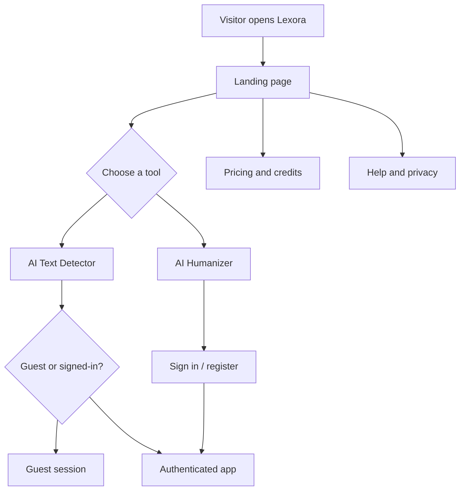
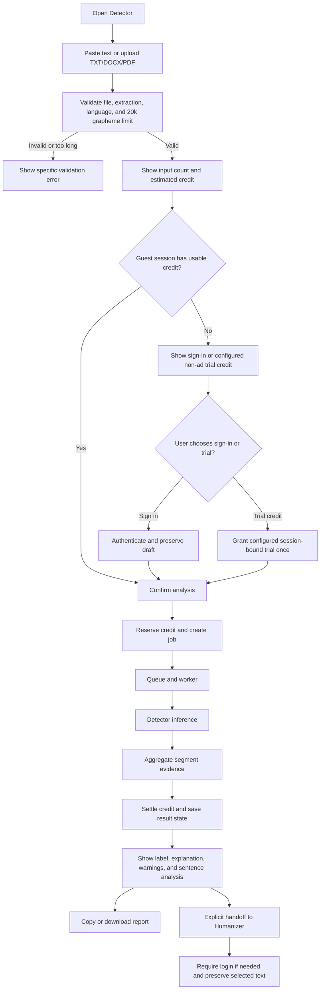
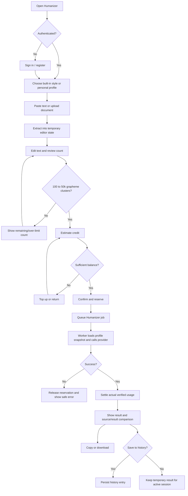
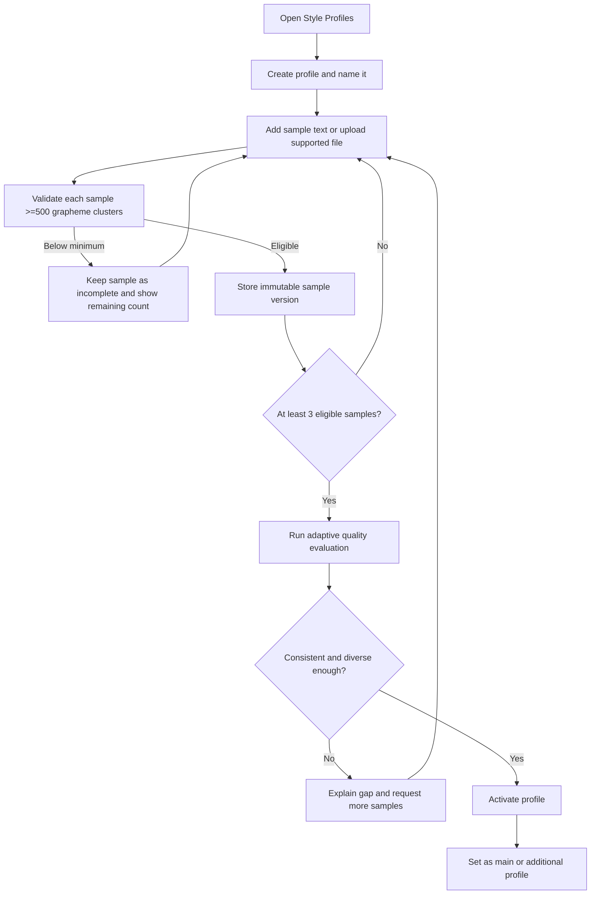
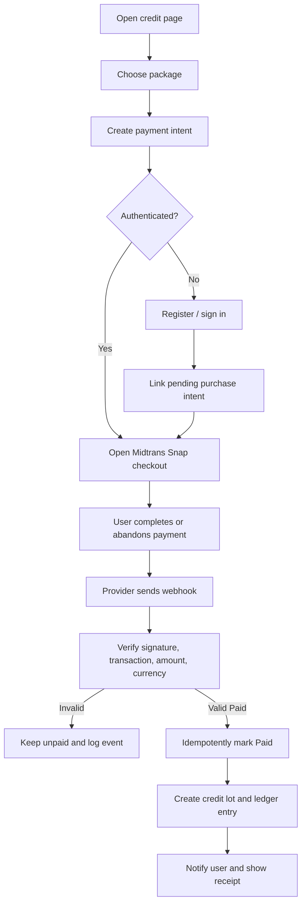
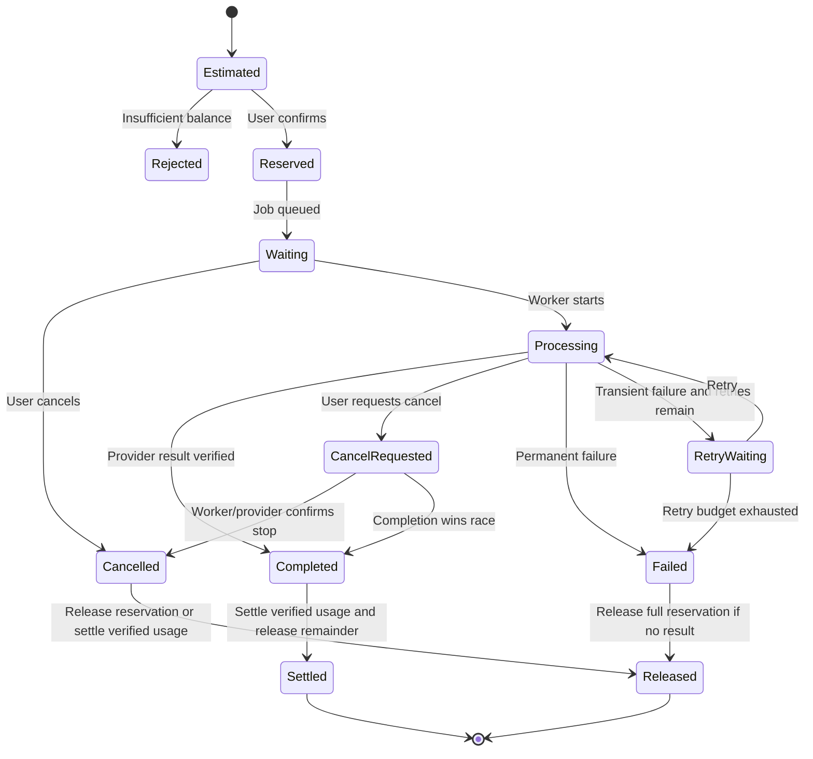
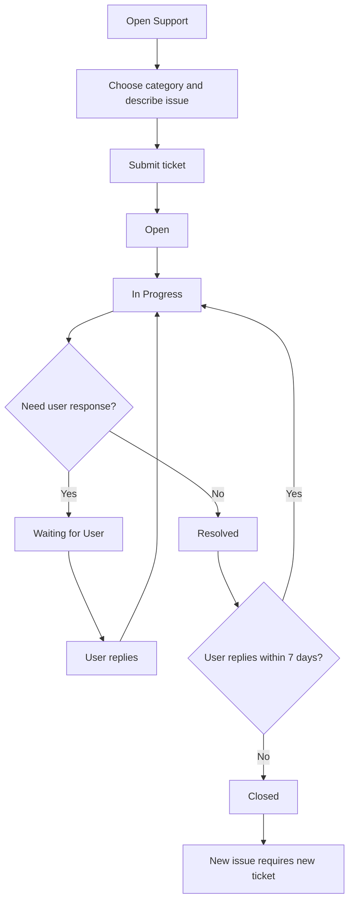
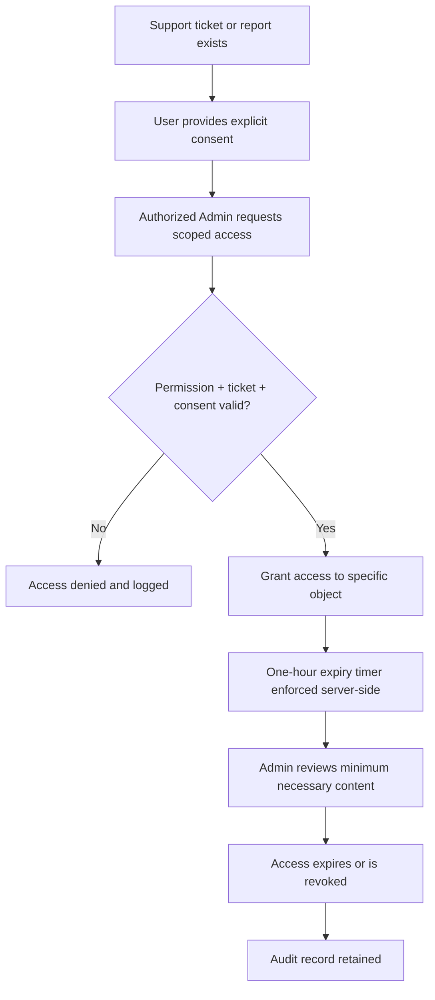
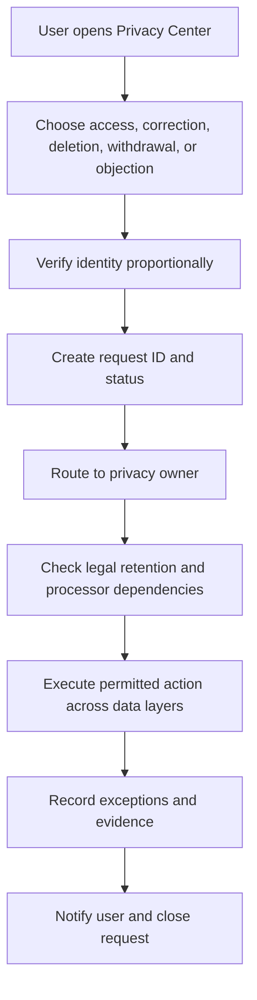
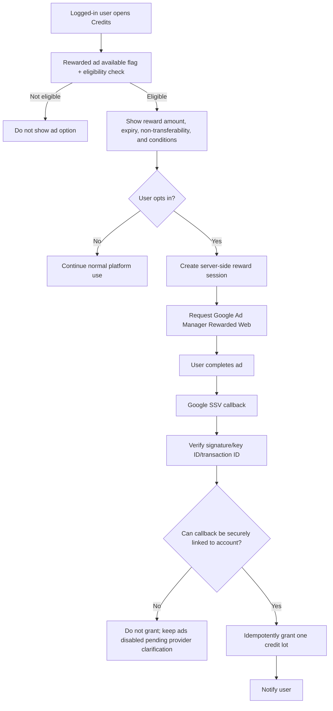

# Lexora User Flows

- **Tanggal:** 2026-11-17
- **Status:** User flow baseline for MVP; detailed visual wireframes are in [UI/UX Specification](UI-UX-SPECIFICATION.md).
- **Source of truth:** SRS and Decision Log. If this document conflicts with SRS, SRS wins.

## 1. Public entry and product discovery

## 2. Guest AI Text Detector

Rules:
- The backend validates the 20,000 extended grapheme limit before reservation or queueing. Guest rewarded ads are disabled on MVP; Guest may receive a configured non-ad trial grant.
- No minimum input is enforced as a hard rejection. If evidence is insufficient, the result is UNCERTAIN.
- Unsupported dominant language returns UNCERTAIN/unsupported language.
- No numeric authorship percentage is shown in MVP.
- A result is not proof of authorship or misconduct.

## 3. Registered AI Humanizer

## 4. Create a personal style profile

A count of three eligible samples is necessary but not sufficient. Adaptive evaluation can request more samples. Maximum 20 samples per profile; maximum six profiles per account.

## 5. Purchase credits

The browser redirect is never sufficient proof of payment. The server-side webhook and reconciliation process determine payment state.

## 6. Credit reservation and job cancellation

## 7. Support ticket

No file attachments are available in MVP. Users should provide ticket IDs, transaction references, and redacted descriptions rather than uploading raw documents.

## 8. Admin sensitive text access

Super Admin does not receive default raw-text access. Moderator has no default access to user text.

## 9. Privacy request

## 10. Notification preferences

- Security and essential transaction notifications remain enabled.
- Promotional notifications require separate opt-in.
- Delivery retries do not alter the underlying transaction/job state.
- Duplicate event IDs create at most one logical notification.

## 12. Flow invariants

1. Backend is authoritative for length, balance, permissions, payment, and job state.
2. No raw text is placed in queue payloads or general logs.
3. A job has one idempotency key across retries.
4. Payment and reward grants are idempotent.
5. Credit balance is derived from ledger entries.
6. Guest credit is not transferred during account conversion.
7. User text is not used for model training by default.
8. A Detector result is never presented as proof of authorship.

## 11. Login-only rewarded ad

Guest rewarded ads are disabled on MVP. Guest can only use a configured non-ad trial grant tied to the Guest session. The web SSV callback fields must be tested before production; do not assume user_id/custom_data are available on the web format.

## 12. Flow invariants
